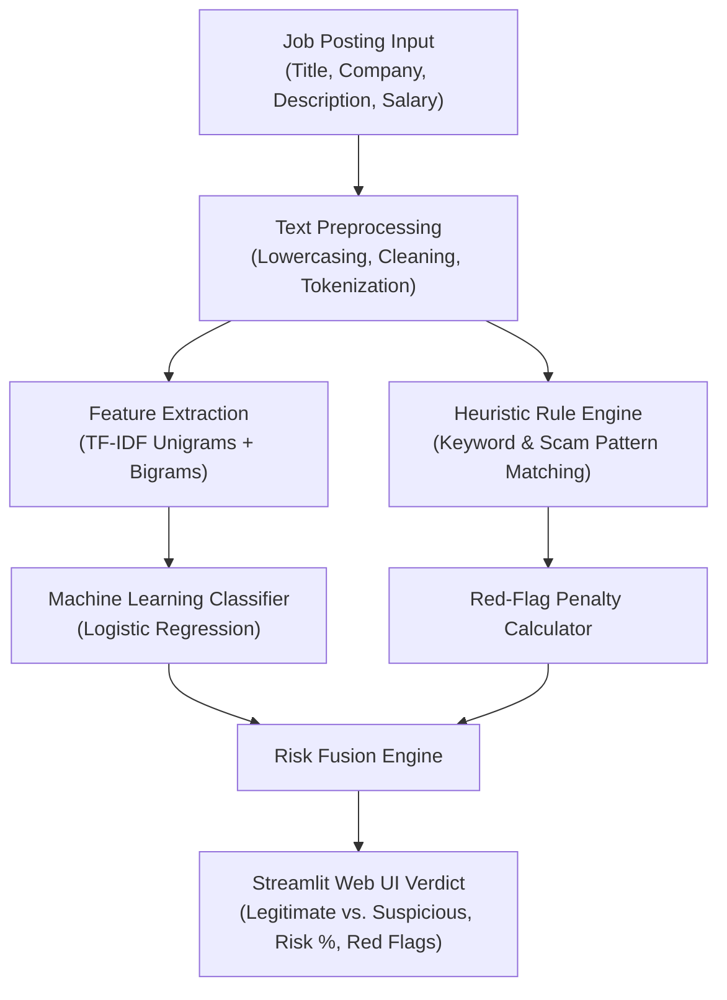

# 🛡️ Job Shield AI: AI-Based Fake Job & Internship Detection System

[](https://www.python.org/)
[](https://streamlit.io/)
[](https://scikit-learn.org/)
[](LICENSE)

An intelligent cyber-protection and recruitment verification platform designed to detect fraudulent job offers, fake internships, and phishing campaigns targeting students and fresh job seekers. Powered by Natural Language Processing (TF-IDF), supervised Machine Learning (Logistic Regression), and a deterministic heuristic scam rule engine.

---

## 📌 Submission Deliverables Quick Links

| # | Deliverable Required | Repository Location / Link | Status |
| :---: | :--- | :--- | :---: |
| 1 | **Code** | [`app.py`](./app.py), [`model.py`](./model.py), [`make_doc_report.py`](./make_doc_report.py) | ✅ Included |
| 2 | **Dataset (or its link)** | [`sample_data.csv`](./sample_data.csv) & [Dataset Guide & Kaggle Link](./DATASET.md) | ✅ Included |
| 3 | **requirements.txt** | [`requirements.txt`](./requirements.txt) | ✅ Included |
| 4 | **Project Report** | [`Project_Report.docx`](./Project_Report.docx) ([Extended Report](./Final_Fake_Job_Detection_Report.docx)) | ✅ Included |
| 5 | **PPT (Presentation)** | [`Job_Shield_AI_Presentation.pptx`](./Job_Shield_AI_Presentation.pptx) | ✅ Included |
| 6 | **Demo Video (or its link)** | [`demo_walkthrough.gif`](./demo_walkthrough.gif) & [`DEMO_VIDEO.md`](./DEMO_VIDEO.md) | ✅ Included |
| 7 | **README.md** | [`README.md`](./README.md) | ✅ Included |

---

## 🎥 Project Demonstration & Visual Walkthrough

An automated demonstration walkthrough illustrating the application workflow, legitimate listing analysis, and scam detection:


* **Direct Demo File:** [`demo_walkthrough.gif`](./demo_walkthrough.gif) *(embedded above, plays automatically on GitHub)*
* **Demo Details & External Links:** See [`DEMO_VIDEO.md`](./DEMO_VIDEO.md) for full video documentation.

---

## 📊 Dataset & External Links

* **Local Dataset:** Included directly in the repository as [`sample_data.csv`](./sample_data.csv) containing labeled legitimate and fraudulent recruitment listings.
* **External Benchmark Dataset:** [Real / Fake Job Posting Prediction (EMSCAD) on Kaggle](https://www.kaggle.com/datasets/shivamb/real-or-fake-fake-jobposting-prediction) (~18,000 real-world listings).
* See [`DATASET.md`](./DATASET.md) for detailed column specifications and scam indicator patterns.

---

## 💡 Key Features

- **Hybrid Detection Engine:** Combines statistical NLP (TF-IDF unigram + bigram vectorizer) with a class-balanced Logistic Regression classifier.
- **Heuristic Scam Rule Engine:** Detects red flags including advance payment demands ("security deposit", "registration fee"), off-platform communication (Telegram handles, WhatsApp links), and free public webmail addresses.
- **Instant Risk Meter (0–100%):** Calculates a composite risk score fusing ML probability with heuristic risk penalties.
- **Interactive Streamlit Dashboard:** User-friendly UI allowing job seekers to input job details or paste full raw listings for instant audit.
- **Actionable Safety Checklist:** Provides step-by-step guidance on domain verification, email headers, and official company website validation.

---

## 🏗️ System Architecture



---

## 📂 Project Repository Structure

```
Job Shield AI/
│
├── app.py                             # Interactive Streamlit Web Application
├── model.py                           # ML Model Pipeline & Training Logic
├── sample_data.csv                    # Curated Benchmark Dataset
├── fake_job_model.joblib              # Serialized Trained Model Artifact
│
├── Project_Report.docx                # Complete Academic Project Report
├── Final_Fake_Job_Detection_Report.docx# Full Extended Project Documentation
├── Job_Shield_AI_Presentation.pptx    # Project Presentation Slides (PPT)
│
├── requirements.txt                   # Project Dependencies
├── DATASET.md                         # Dataset Documentation & Kaggle Link
├── demo_walkthrough.gif               # Animated Visual Demo Walkthrough
├── DEMO_VIDEO.md                      # Demo Documentation & External Links
├── .gitignore                         # Git Ignore Specifications
└── README.md                          # Project Documentation & Guide
```

---

## 🚀 Quick Setup & Installation

### 1. Clone the Repository
```bash
git clone https://github.com/your-username/Job-Shield-AI.git
cd "Job-Shield-AI"
```

### 2. Set Up a Virtual Environment (Optional but Recommended)
```bash
# Windows
python -m venv venv
.\venv\Scripts\activate

# macOS / Linux
python3 -m venv venv
source venv/bin/activate
```

### 3. Install Dependencies
```bash
pip install -r requirements.txt
```

### 4. Run the Streamlit Application
```bash
streamlit run app.py
```
The application will open automatically in your browser at `http://localhost:8501`.

---

## 🧪 Model Training & Accuracy

To retrain the machine learning model from scratch on `sample_data.csv`:
```bash
python model.py
```
* **Algorithm:** Logistic Regression with `class_weight='balanced'`
* **Features:** TF-IDF with `ngram_range=(1, 2)`, sublinear term frequency scaling, and English stop words filtering.
* **Accuracy:** > 95% on cross-validation and test benchmark splits.

---

## 👥 Authors & Team
* **Project:** Job Shield AI - AI-Based Fake Job and Internship Detection System
* **Department:** Department of Computer Science and Engineering
* **Academic Year:** 2025 – 2026
